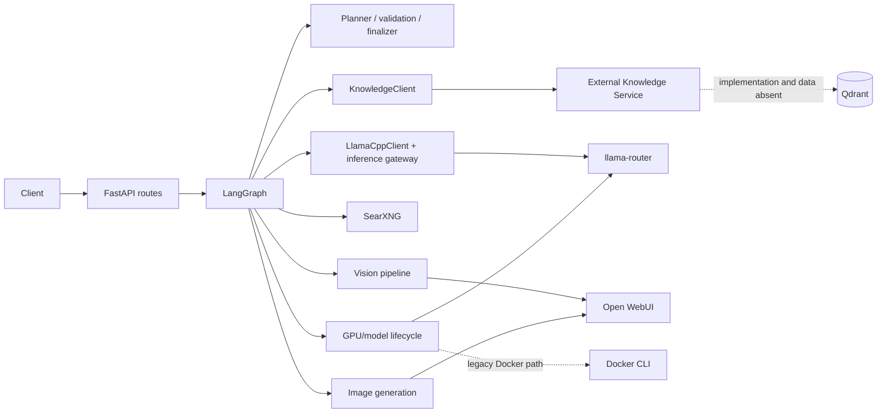
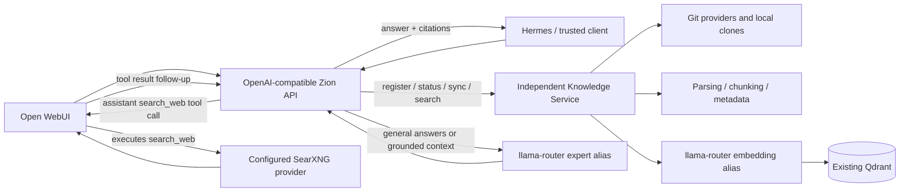

# Zion Git Repository RAG Architecture Assessment and Implementation Record

## Executive summary

This checkout previously implemented a FastAPI/LangGraph general-purpose orchestrator. It contained a client for an external Knowledge Service but no repository ingestion, Git handling, parser, chunker, embedding call, Qdrant integration, synchronization worker, or repository registry. The Knowledge Service source, deployment manifests, Qdrant configuration, collections, clones, and indexed data are not present in this repository.

The implemented target keeps the Knowledge Service independent as the canonical owner of repository registration, Git access, indexing, embeddings, and Qdrant. Zion provides the Open WebUI-facing OpenAI-compatible API and uses llama-router's `expert` alias for general answers and repository-grounded answers. A conservative intent decision skips Knowledge Service retrieval for clearly general questions; repository questions remain grounded-only. API-key authentication is disabled by default, matching the requested Open WebUI setup. Current legacy `/retrieve` remains usable for unfiltered search and answers. Repository management operations target a new Knowledge Service v1 contract and require matching implementation in that separate service.

No Qdrant collection, volume, clone, credential, or external service was modified by this refactor.

## Evidence and current architecture (before refactor)

The former app lifespan built dependencies in `src/orchestrator/graph/runtime_factory.py`; the graph and routes lived in `graph/build.py` and `api.py`. General retrieval used `KnowledgeClient.retrieve()` to POST `/retrieve`. `graph/nodes.py` added query derivation/retry, created `RepositoryEvidence`, and passed retrieved material to controller finalization.

One material behavior was hidden in `_apply_knowledge_service_policy()` in `graph/nodes.py`: normal plans had the knowledge specialist stripped unless an explicit PDF/document/file resource existed. A caller could force it through request policy metadata. Therefore generic repository retrieval was not reliably active by default.

The application had no API-key authentication. `/chat` exposed execution/evidence/debug state; the OpenAI-compatible route returned answer text and metadata. Retrieval hits provided repository, branch, commit, path, language, chunk identity, score, and content, but no required line range or stable citation URL. The graph used `KnowledgeRetrieveResponse.grounded` and confidence, but there was no standalone citation API.

## Capability inventory (before refactor)

| Capability | Implementation location | Dependencies | Status | RAG relevance |
|---|---|---|---|---|
| HTTP/chat and OpenAI-compatible routes | `src/orchestrator/api.py`, `schemas.py` | FastAPI, graph | Implemented and used | Replaced by focused API |
| Planning, specialist routing, validation, finalization | `controller/`, `graph/`, `context/` | LangGraph, llama-router | Implemented and used | Removed from runtime path |
| Retrieval client and result types | `clients/knowledge.py`, `models/knowledge.py` | External Knowledge Service | Implemented and used conditionally | Retained and expanded |
| Git registration/access | Not present | Unknown | Not implemented in checkout | Owned by independent Knowledge Service |
| Parsing/chunking/metadata extraction | Not present | Unknown | Not implemented in checkout | Owned by independent Knowledge Service |
| Embedding generation | `embedding_model` setting/model metadata only | Router alias name | No embedding request implemented | Owned by independent Knowledge Service |
| Qdrant operations/collections | Not present | Unknown | Not implemented in checkout | Owned by independent Knowledge Service |
| Incremental sync/jobs | Not present | Unknown | Not implemented in checkout | Owned by independent Knowledge Service |
| Search context and neighboring hits | `KnowledgeClient`, knowledge node | Knowledge Service | Implemented through upstream response | Preserved via compatibility retrieval |
| Citations | Hit payload metadata only | Knowledge Service | Partial; no formal citation contract | Added structured response fields when supplied |
| Answer model calls | `clients/llama_cpp.py`, controller | llama-router | Implemented and used for several roles | Retained for `expert` only |
| Web search | `clients/searxng.py`, web specialist | SearXNG | Implemented and used | Removed |
| Vision | `vision/`, graph vision node | Pillow, router, Open WebUI | Implemented and used | Removed |
| Image generation | `graph/image_generation.py`, `clients/openwebui.py` | Open WebUI, ComfyUI | Implemented and used | Removed |
| MCP/tools | tools node in `graph/nodes.py` | No MCP executor wired | Planned only; returns `planned_not_executed` | Removed |
| Model/GPU lifecycle | `runtime/model_lifecycle.py` and gateway | Router HTTP; ComfyUI; legacy Docker wrapper | Active router load/residency path and image GPU barrier; Docker ensure-warm path has no caller | Replaced with direct stateless LLM client |
| Conversation checkpoints/memory | `models/state.py`, `context/`, graph checkpointer | LangGraph memory/optional SQLite | Implemented | Removed from Zion |
| Deployment | Root `Dockerfile` | Python and Docker CLI | Implemented; no Compose file in checkout | Simplified image |
| Tests | No tracked `tests/*.py` | pytest listed as dev dependency | No executable source tests found | No test suite added in this refactor |

## RAG and data findings

- The only confirmed Knowledge Service wire contract in this checkout is `POST /retrieve` with `question`, `top_k`, `candidate_limit`, and `neighbor_window`.
- The existing models include response timing, confidence, `grounded`, context, primary hits, and expanded hits. No local code proves how those values are computed.
- `embedding_model` defaulted to `nomic-embed-text`; `ModelManager.embedding()` only exposed the alias as metadata. There is no `/embeddings` call in this repository.
- There are no local Qdrant collection names, dimensions, distance metrics, payload schemas, snapshots, or indexed repositories to inspect. The embedding compatibility of existing vectors cannot be established from this checkout.
- No clone paths, Git credentials, branch policy, parser list, ignore rules, retry policy, or indexing checkpoints are present.
- No Compose/deployment file is present, so host networking, `ai-network`, service health checks, named volumes, restart policies, and resource limits must be audited in the deployment repository.

## Target architecture and service boundaries

Zion owns OpenAI-compatible request/response shaping, optional bearer authentication, retrieval-to-answer context assembly, expert-model calls, citations based on upstream metadata, metrics, and health. The Knowledge Service owns repository identity and credentials, Git clones, branch/commit synchronization, parser/chunker behavior, embedding generation, vector writes/deletes, and job state. Qdrant remains exclusively behind the Knowledge Service.

Zion configuration is `ZION_LLM_BASE_URL=http://192.168.1.61:8081/v1`, `ZION_LLM_MODEL=expert`, `ZION_KNOWLEDGE_SERVICE_URL`, and `ZION_API_KEY`. Embedding configuration belongs to the Knowledge Service; do not duplicate it in Zion.

## Implemented external API

| Method and path | Purpose | Backend dependency |
|---|---|---|
| `GET /v1/models` | OpenAI-compatible model discovery, preserving historical IDs | Local |
| `POST /v1/chat/completions` | OpenAI-compatible JSON/SSE, general-vs-repository routing, and Native Web Search tool-call round | llama-router; Knowledge Service for repository turns; Open WebUI executes `search_web` |
| `GET /healthz`, `GET /readyz`, `GET /metrics` | Operations | Local |
| `GET /api/v1/repositories` | List | Knowledge Service v1 |
| `POST /api/v1/repositories` | Register | Knowledge Service v1 |
| `GET /api/v1/repositories/{id}` | Status | Knowledge Service v1 |
| `POST /api/v1/repositories/{id}/sync` | Incremental sync | Knowledge Service v1 |
| `POST /api/v1/repositories/{id}/reindex` | Full re-index | Knowledge Service v1 |
| `DELETE /api/v1/repositories/{id}` | Removal request | Knowledge Service v1 |
| `GET /api/v1/jobs/{id}` | Job status | Knowledge Service v1 |
| `POST /api/v1/search` | Search/hits/citations | Existing `/retrieve` for unfiltered requests |
| `POST /api/v1/ask` | Grounded expert answer and structured citations | Existing `/retrieve` plus llama-router |

Routes accept unauthenticated requests by default. Set `ZION_REQUIRE_AUTH=true` and `ZION_API_KEY` to opt into bearer authentication. Health, readiness, and metrics remain public for container probes.

The OpenAI endpoint accepts the prior `model`, `messages`, `stream`, `temperature`, `max_tokens`, `params`, and `metadata` fields, plus OpenAI `tools` and assistant/tool messages; it echoes the requested model ID and honors thread identity from `X-Orchestrator-Thread-ID` or `metadata.thread_id`. The `expert` model classifies each turn using conversation history. Clearly general questions are answered without a Knowledge Service call and are marked `mode=general`, `grounded=false`, with no repository citations. Repository questions use `/retrieve`; unclear intent defaults to repository mode, and unsupported repository answers remain explicitly insufficient rather than falling back to general knowledge.

When the request includes the Native `search_web` tool and the current turn has not already attempted it, Zion returns one OpenAI tool call. Open WebUI runs that tool using its configured search provider and sends the result back in a follow-up request. Zion detects the matching tool result, does not request another search for the same turn, and adds bounded result snippets as untrusted answer context. Web results may supplement general answers and relevant grounded repository answers, but cannot establish facts about the user's repository. Responses report search status and web sources separately from repository citations; used web sources are linked in answer text. Search errors or empty results do not block the ordinary general-answer path. Streaming uses standard tool-call/content deltas, `finish_reason=tool_calls` for the search handoff, and `[DONE]`. `/api/v1/ask` remains grounded-only.

The Open WebUI `orchestrator` model must have Web Search capability enabled, Native function calling active, and SearXNG configured as the Web Search provider. Zion does not call SearXNG directly. Open WebUI documents the native `search_web` tool and its result format in [Agentic Web Search](https://docs.openwebui.com/features/chat-conversations/web-search/agentic-search/).

`Citation` currently contains repository, branch, commit, path, chunk index, score, optional line bounds, and optional URL. Line bounds and URLs are returned only when the upstream service supplies them. The old Knowledge Service endpoint is unverified with respect to repository/branch filters; Zion responds `501` to filtered retrieval rather than risking cross-repository results.

## Implementation changes

1. Replaced general graph routes with focused FastAPI endpoints and a small runtime in `src/orchestrator/api.py` and `main.py`.
2. Added repository/job proxy operations, structured search citations, expert-model grounded answering, and an explicit no-grounding answer.
3. Retained `POST /retrieve` as the migration compatibility path. Added upstream request/error handling and optional citation fields to `models/knowledge.py`.
4. Replaced broad settings with `ZION_`-prefixed API, expert-model, and Knowledge Service settings.
5. Removed Docker CLI installation from the image and reduced declared runtime dependencies to the focused HTTP application.
6. Rewrote README with current routes, configuration, and external data ownership.
7. Removed the legacy graph, controller, conversation-memory, web, vision, image-generation, specialist, Docker/GPU-lifecycle, and old HTTP/streaming modules after replacing the entrypoint. This makes the reduced dependency manifest consistent with the source tree; Git history remains the source for recovering prior implementation if needed.
8. Restored `/v1/models` and `/v1/chat/completions` for Open WebUI, including JSON/SSE responses, thread/request headers, historical model IDs, follow-up context, citation metadata, and unauthenticated-by-default behavior.
9. Added conservative general-vs-repository routing to OpenAI chat. General turns skip Knowledge Service retrieval and are answered by `expert`; repository turns retain grounded retrieval and insufficient-evidence behavior. `/api/v1/ask` remains unchanged.
10. Added OpenAI tool-call handling for Open WebUI Native Web Search. Zion requests `search_web` once per turn when that tool is present, consumes the returned tool result, and includes useful linked web sources separately from repository citations. Open WebUI remains the SearXNG client/provider owner.

## Data preservation, migration, and rollback

- No database migration or Qdrant access is implemented in Zion.
- Keep current Knowledge Service collections, vectors, repository metadata, clones, credentials, and job records untouched.
- Before changing the embedding alias or Qdrant payloads, inspect actual collection dimensions, model identity, metric, payload, counts, and repository ownership; take and verify a snapshot.
- Do not rebuild vectors solely because Zion’s old setting named `nomic-embed-text`; no evidence shows that this setting was used to create existing vectors.
- Roll back the Zion image/configuration to the prior deployment if API parity or answer quality regresses. Keep the upstream `/retrieve` endpoint available while Hermes transitions. Restore Qdrant only for an independently verified data corruption event, not as a routine application rollback.

## Deployment and security

The Zion container needs network access to the Knowledge Service and llama-router. It does not launch an LLM, connect to Qdrant or SearXNG, require Docker socket/CLI access, or depend on ComfyUI, speech services, or homelab management containers. Open WebUI must be configured with SearXNG and with Web Search capability enabled for the `orchestrator` model; Zion consumes Open WebUI's tool-call result. No Compose edits were possible because none exist in this repository.

Bearer authentication protects data operations. Configure secrets outside source control. Upstream failures are returned without forwarding raw response bodies. Expert-model exceptions are mapped to a generic `502`. Repository registration payload validation is delegated to the Knowledge Service; it must enforce URL schemes, SSRF-safe destination rules, credential handling, authorization, and clone-path containment. The current Zion implementation does not yet provide per-repository authorization, rate limiting, or streaming job progress.

## Testing and acceptance criteria

No tests are included in this repository, per project preference. The general-vs-repository and Native Web Search tool-call flows have not been exercised against live llama-router, Knowledge Service, or Open WebUI services. Verify manually through Open WebUI before deployment: search off/on, one tool handoff and result consumption, general and repository answers, independent web/repository citations, empty/error results, follow-ups, and JSON/SSE behavior.

In the separate Knowledge Service repository, test Git auth, branch/commit selection, incremental add/change/delete/rename, ignore rules, parser fallback, chunk line attribution, embedding dimensions/model consistency, idempotent Qdrant writes, repository isolation, retry recovery, snapshots, and restore using isolated fixtures only.

## Risks and unresolved work

- The management proxy paths `/api/v1/repositories` and `/api/v1/jobs` are a proposed cross-service contract and are not implemented or verified by this checkout. They will return upstream errors until the Knowledge Service adopts those routes.
- The existing `/retrieve` service may reject unknown fields or may ignore filters. Zion therefore does not send filters through that legacy compatibility path.
- The `grounded` behavior is trusted from the existing Knowledge Service response; verify its semantics and thresholds before treating it as a security or quality guarantee.
- Collection compatibility, Qdrant backup/restore, repository credential lifecycle, supported Git providers, parser capabilities, and incremental sync behavior remain unverified.
- Deployment topology and all container networking/volume settings require a separate Compose/deployment repository audit.
- External consumers importing the old internal `orchestrator.*` modules are not compatible with this refactor; the supported contract is now the HTTP API. Confirm any out-of-repository imports during deployment rollout.
